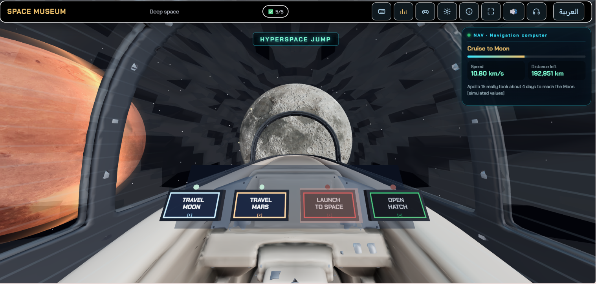
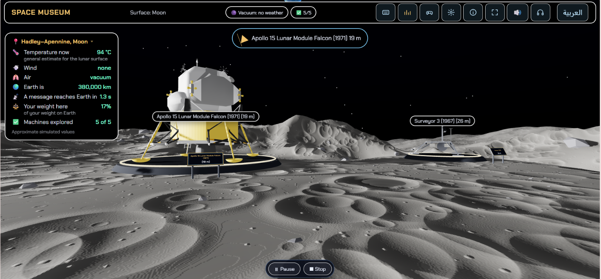
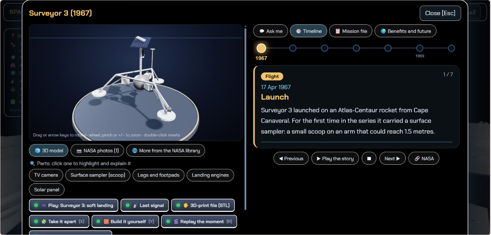
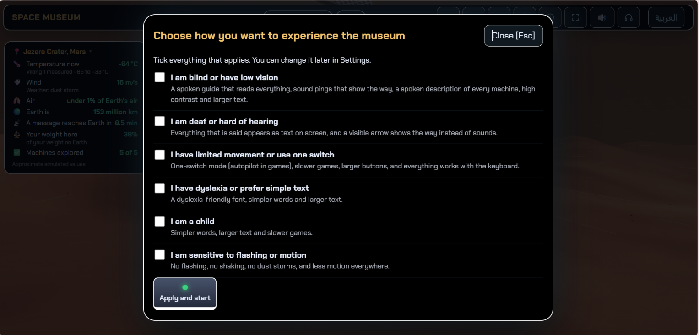

# Space Museum

**Walk among the machines humans left on the Moon and Mars. Hear their stories. Play their missions.**

Team Arasyn · 3rd Place Winner · NASA Space Apps Challenge · Challenge: *Discarded Equipment Storytelling*

## Try it

- **Play the museum in your browser:** [https://noortalal3.github.io/Space-Museum/](https://noortalal3.github.io/Space-Museum/)

Works best in Chrome or Edge on a computer. It requires an internet connection the first time to load the 3D library, and may take a few seconds on initial load.

## What it is

Space Museum is a 3D museum that runs in the browser. Visitors board a spaceship cockpit, fly to the Moon or Mars, and step out to walk, run and jump in real lunar or Martian gravity, with Earth hanging in the lunar sky.

Five real machines wait for them:

| Machine | Where | Year |
|---|---|---|
| Surveyor 3 | Moon | 1967 |
| Apollo 15 Lunar Module *Falcon* | Moon | 1971 |
| Viking 1 Orbiter | Mars orbit | 1976 |
| Viking 1 Lander | Mars | 1976 |
| Ingenuity Mars Helicopter | Mars | 2021 |

For every machine, visitors can:

- **Hear its story:** a voiced timeline (up to 16 stops) that reshapes the 3D model at each stop.
- **Explore its parts:** tap a part to highlight it, see what it did and an idea for recycling it.
- **Ask it questions** and get answers with their source.
- **See why it matters:** how it still benefits Earth today, and how it could help people living there one day.
- **Play a short game** built on its real mission.

Commander Nova welcomes visitors at the reception, leads a guided tour, and gives a visitor pass and a time capsule.

## Who it is for

School students and people with disabilities. The visitor chooses how to experience the museum:

- Blind or low vision: full audio guide, spoken descriptions, sound that shows the way, high contrast.
- Deaf or hard of hearing: every spoken word on screen, a visible arrow instead of sounds.
- Limited movement: one-switch mode, assisted games, keyboard only.
- Dyslexia and children: easy-read text, larger text, slower games.
- Sensitive to motion: no flashing, no shaking, no dust storms.

Everything is in **Arabic and English**, with 638 recorded voice lines.

## Controls

| Key | Action |
|---|---|
| W A S D / arrows | Walk |
| Shift | Run |
| J | Jump |
| E | Open the nearest machine |
| Space | Describe the nearest machine |
| P | Pause or continue speech |
| M | Mute |
| Esc | Close a window |

## Sources and AI use

- Facts, dates and numbers come from official NASA mission pages and catalogue records; the source is shown under each answer in the museum.
- The code was written with an AI assistant (Claude). The voices were generated with ElevenLabs.
- Ideas about the future are labelled as ideas to imagine, not agency plans.
- The 3D library is three.js (MIT licence).
